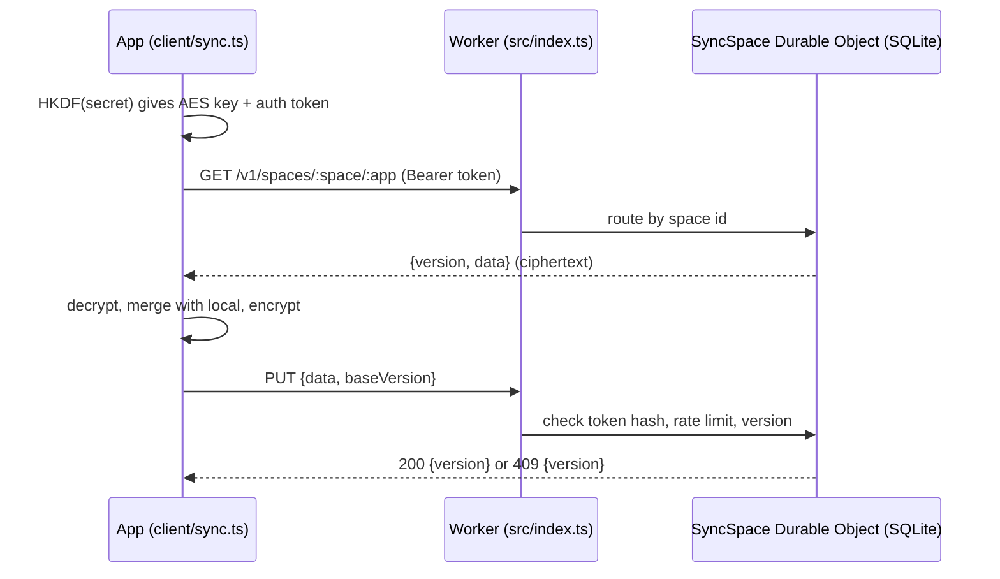

# Sync API

End-to-end encrypted sync for small web apps, so the same data appears on a phone and a laptop without an account or password. A single sync code is shared between devices. Each device uses it to derive both an AES-256-GCM key and a separate auth token, so the secret itself never reaches the server. The backend is a Cloudflare Worker with one SQLite-backed Durable Object per sync space. It stores only ciphertext and uses optimistic versioning to detect conflicting writes.

[](https://github.com/Sabin78910/sync-api/actions/workflows/ci.yml)
[](LICENSE)

**Live:** health check at https://sync-api.sabin-apps.workers.dev/v1/health

## Overview

- **Client-side encryption:** AES-256-GCM with a fresh 12-byte IV on every write. The app name is bound as associated data, so a document cannot be replayed into another app.
- **No accounts:** a sync code has the form `SS1-<space id>-<secret>`, with a 128-bit random space id and a 256-bit secret. HKDF-SHA-256 derives an encryption key and a separate 256-bit auth token from the secret.
- **Minimal server-side secrets:** the server stores only the SHA-256 hash of the auth token and compares hashes in constant time. The first valid write claims an empty space.
- **Conflict detection:** every write carries a `baseVersion`. A stale write gets `409` with the current version, and the client pulls, merges with an app-supplied function and retries.
- **Abuse limits:**
  - 256 KB per app document.
  - Requests over 300 KB are rejected before parsing.
  - 30 writes per sliding minute per space, persisted in storage.
  - CORS is allowed only for the apps' origins.
- **Data lifecycle:** `DELETE` erases a whole space. A Durable Object alarm deletes spaces that nobody has written to for 365 days.
- **Dependency-free client:** `client/sync.ts` uses only WebCrypto and `fetch`, and is copied into each app.

## How it works



1. The app creates a sync code with `newSyncCode()`. The user copies or scans it on a second device.
2. The Worker validates the path (22-character space id, 2–32 character app name) and applies CORS. It then routes the request to the space's Durable Object by name.
3. The Durable Object checks the bearer token against the stored hash. For writes, it also applies the rate limit and compares `baseVersion` with the current version.
4. Accepted writes bump the version, store the ciphertext and reset the idle-expiry alarm.

| Endpoint | Purpose |
|---|---|
| `GET /v1/health` | Liveness: `{"ok": true, "service": "sync-api", "e2e": true}` |
| `GET /v1/spaces/:space/:app` | Encrypted document and version (Bearer auth token) |
| `PUT /v1/spaces/:space/:app` | `{data, baseVersion}`; the first write claims the space |
| `DELETE /v1/spaces/:space` | Erase everything in the space |

Every response sets `Cache-Control: no-store`, `X-Content-Type-Options: nosniff` and `Referrer-Policy: no-referrer`.

## Getting started

Prerequisites: Node.js 22 (the version CI uses) and npm. Deploying requires a Cloudflare account.

```bash
npm ci
npm test            # Vitest
npm run typecheck   # tsc --noEmit
npm run dev         # wrangler dev, local Worker with Durable Objects
npm run deploy      # wrangler deploy
```

To use it in an app, copy `client/sync.ts` into the app, then:

```ts
const code = localStorage.getItem("syncCode") ?? newSyncCode();
const sync = new SyncClient(code, "todo-web");
const { value, version } = await sync.sync(localTodos, lastVersion, mergeById);
```

## Project structure

| Path | Purpose |
|---|---|
| `src/index.ts` | Worker entry: routing, CORS preflight, request size check, security headers, `SyncSpace` Durable Object (SQLite tables, expiry alarm) |
| `src/space.ts` | Storage-independent request handlers: validation, auth, rate limit, versioning, expiry, CORS allow-list |
| `src/sync.test.ts` | Vitest suite for handlers, client crypto and end-to-end sync |
| `client/sync.ts` | Browser client: sync codes, HKDF, AES-GCM, `SyncClient` with pull, push and merge |
| `wrangler.toml` | Worker, Durable Object binding and SQLite migration |
| `.github/workflows/` | CI, deploy and CodeQL workflows |

## Testing and CI

`src/sync.test.ts` has 20 Vitest cases. The handlers run against an in-memory `SpaceStorage`. The client runs against a fake `fetch` that routes to the real handlers, so the full encrypt-push-pull-decrypt path is exercised without the Workers runtime. The suite covers:

- **Validation:** id and app-name validation and the CORS allow-list.
- **Auth:** constant-time comparison, space claiming, wrong-token refusal and owner-only delete.
- **Writes:** stale-write `409`s, body and size checks, rate limiting and app isolation.
- **Lifecycle:** idle expiry.
- **Client crypto:** sync-code parsing, key derivation, decryption failing with the wrong key or app, and fresh IVs.
- **End to end:** two-device sync and conflict merging.

| Workflow | Trigger | Runs |
|---|---|---|
| `ci.yml` | Push and PR to `main`, manual | `npm ci`, typecheck, `npm test`, `wrangler deploy --dry-run`, `npm audit --audit-level=high --omit=dev` (Node 22) |
| `deploy.yml` | Push to `main`, manual | Tests, then `wrangler deploy` and a smoke test of `/v1/health` (up to 5 tries). Skips with a notice if the Cloudflare secrets are not set |
| `codeql.yml` | Push and PR to `main`, manual | CodeQL analysis for JavaScript/TypeScript |

## Design decisions and limitations

- **Testable without the Workers runtime.** Request logic sits behind a small `SpaceStorage` interface, so it can be unit-tested without Cloudflare. The Durable Object and SQLite wiring in `src/index.ts` is checked only by the dry-run build and the post-deploy health check.
- **The sync code is the only credential.** Anyone who holds it can read, overwrite or delete the space. There is no rotation or revocation, and a lost code means the data cannot be decrypted.
- **Metadata is visible to the server.** Content is encrypted, but the server sees space ids, app names, document sizes and write times. An unclaimed space goes to whoever writes first, so its protection rests on the random 128-bit space id.
- **Merging is left to each app.** The server versions whole documents only. `SyncClient.sync()` gives up after three conflicting attempts.
- **Coarse limits.** Rate limiting is per space, not per client. The 300 KB early rejection relies on the `Content-Length` header, and the 256 KB document limit is enforced after parsing.

## License

MIT. See [LICENSE](LICENSE).

## Author

**Sabin Khanal**: [Portfolio](https://sabinkhanal13.com.np) · [LinkedIn](https://www.linkedin.com/in/sabin-khanal-950163326) · [GitHub](https://github.com/Sabin78910)
